<picture>
  <source media="(prefers-color-scheme: dark)" srcset="assets/banner-dark.svg">
  
</picture>

I'm Andrew, an energy and technology professional with more than a decade in the US gas & electric
utility sector, working as a data & business analyst, software developer and test manager. I have a passion
for process improvement and IT transformation projects, and I research AI, robotics and quantum computing,
including an MSc thesis on long-context LLM inference. Most of my work lives in private repositories, so the
cards below show what each project does. Demos and code walk-throughs are available on request.

## Research highlights

<picture>
  <source media="(prefers-color-scheme: dark)" srcset="assets/hero/outage-risk-dark.svg">
  
</picture>

<b>Outage risk from short outages</b> · private · what it is

- In flight the drone briefly stops passing its Lighthouse positioning to its estimator in flight while the positioning system keeps computing a reference from the same light, so drift (estimate − reference) is measured directly; a drone's own safe 1–1.5 s outages are used to predict its longer ones.
- Hardware lab days with Crazyflies are under way; the method has already been replicated offline on six public flight datasets.
- Offline, abort limits set from simulators with datasheet IMU noise are exceeded on 82–100 % of held-out 3 s outages (target 10 %), and with tracked-flight-fitted noise on 92–100 % for four of six datasets; limits from the drone's own short outages on 10–23 %.

<picture>
  <source media="(prefers-color-scheme: dark)" srcset="assets/hero/drone-dark.svg">
  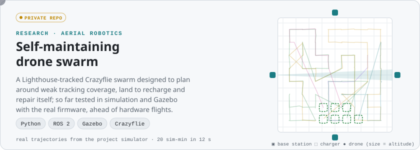
</picture>

<b>Self-maintaining drone swarm</b> · private · what it is

- Grew out of a University of Bern seminar brief on localization-quality-aware trajectory planning for aerial swarms.
- Localization-quality-aware planning, self-repair and decentralized control for a Lighthouse-tracked Crazyflie swarm designed to recharge itself (demonstrated in simulation so far).
- Tested in a custom simulator and in Gazebo running the real Crazyflie firmware (CrazySim); hardware flights come next.

<picture>
  <source media="(prefers-color-scheme: dark)" srcset="assets/hero/quantum-dark.svg">
  
</picture>

<b>Error-corrected quantum circuits</b> · private · what it is

- Research into fault-tolerant quantum computing with surface-code error correction.
- Works with benchmark circuits in OpenQASM and simulates how logical qubits detect and correct physical errors.
- The card above is a textbook illustration of the idea, not project output.

<picture>
  <source media="(prefers-color-scheme: dark)" srcset="assets/hero/voice2vision-dark.svg">
  
</picture>

<b>Voice to Vision</b> · private · what it is

- Speech goes through Whisper, then an LLM director, then SD-Turbo, and the picture is refined phrase by phrase while you talk.
- Code owns the state: the LLM only chooses among options the code offers, and clear cases are handled by fast local rules.
- A sibling tool, Voice to UI, builds working UI prototypes by voice and exports them as HTML.

<a href="https://github.com/Rikoleurt/ASE_Group3"><picture> <source media="(prefers-color-scheme: dark)" srcset="assets/hero/linear-a-dark.gif"> 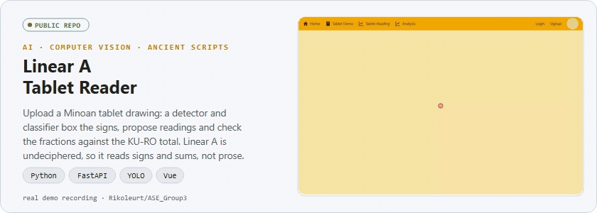 </picture></a>

<b>Linear A Tablet Reader</b> · <a href="https://github.com/Rikoleurt/ASE_Group3">ASE_Group3</a> · what it is · full-resolution demo

- Upload a Linear A tablet drawing: a sign detector and a classifier (YOLO) locate the signs and propose readings, with hover details for each sign.
- Quantities and fractions are interpreted and checked against the KU-RO ("total") entry, showing whether the tablet's arithmetic balances.
- Vue frontend, FastAPI backend and a corpus-based reading view; Linear A is undeciphered, so the app reads signs and arithmetic, not language.

https://github.com/user-attachments/assets/a9dcaa56-567a-4865-9641-fb5758889c16

<a href="https://ravensstats.github.io/RavensStats/"><picture> <source media="(prefers-color-scheme: dark)" srcset="https://raw.githubusercontent.com/RavensStats/RavensStats/output/snake-dark.svg"> 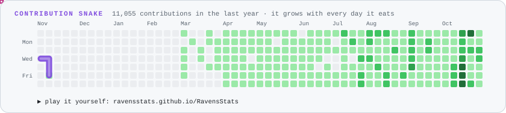 </picture></a>

## More projects

<table>
<tr>
<td width="50%"><picture><source media="(prefers-color-scheme: dark)" srcset="assets/tiles/thesis-dark.svg">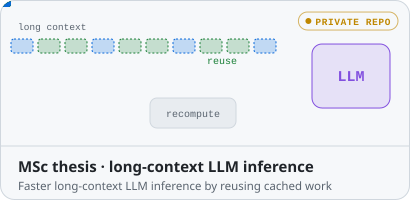</picture>
 Research · Python · PyTorch · Hugging Face · private</td>
<td width="50%"><picture><source media="(prefers-color-scheme: dark)" srcset="assets/tiles/final-platform-dark.svg">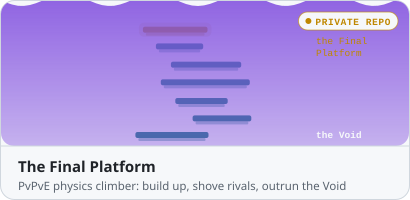</picture>
 Game · Unity 6 · URP · Netcode · Steam · private</td>
</tr>
<tr>
<td><picture><source media="(prefers-color-scheme: dark)" srcset="assets/tiles/battleblips-dark.svg"></picture>
 Game · Unity 6 · procedural meshes and shaders · private</td>
<td><picture><source media="(prefers-color-scheme: dark)" srcset="assets/tiles/doodle-coaster-dark.svg"></picture>
 Game · Unity · C# · private</td>
</tr>
<tr>
<td><a href="https://store.steampowered.com/app/4841870/Hephaestus_Protocol/"><picture><source media="(prefers-color-scheme: dark)" srcset="assets/tiles/hephaestus-protocol-dark.svg"></picture></a>
  Game · Unity 6 · C#</td>
<td><picture><source media="(prefers-color-scheme: dark)" srcset="assets/tiles/candy-kings-dark.svg"></picture>
 Game · Unity 6 · 2D URP · local co-op · private</td>
</tr>
<tr>
<td><a href="https://github.com/RavensStats/rosviz-web"><picture><source media="(prefers-color-scheme: dark)" srcset="assets/tiles/rosviz-dark.svg"></picture></a>
 App · <a href="https://github.com/RavensStats/rosviz-web">rosviz-web</a> · ROS 2 · Prometheus · Grafana · Next.js · Docker</td>
<td><a href="https://github.com/RavensStats/FantasyFootballScripts"><picture><source media="(prefers-color-scheme: dark)" srcset="assets/tiles/fantasy-dark.svg"></picture></a>
 App · <a href="https://github.com/RavensStats/Rocket-Raccoon-Pod">league pages</a> (customized fork of league-page) · <a href="https://github.com/RavensStats/FantasyFootballScripts">scripts</a> · Svelte · Python</td>
</tr>
<tr>
<td><picture><source media="(prefers-color-scheme: dark)" srcset="assets/tiles/proth-prime-search-dark.svg"></picture>
 Research · C · Python · Oracle Cloud · private</td>
<td><a href="https://github.com/MateoLopez00/SafeSplit_Distributed_DL"><picture><source media="(prefers-color-scheme: dark)" srcset="assets/tiles/backdoor-robustness-dark.svg"></picture></a>
 Research · <a href="https://github.com/MateoLopez00/SafeSplit_Distributed_DL">SafeSplit reproduction</a> (NDSS 2025) · <a href="https://github.com/MateoLopez00/DL-Backdoor-Attacks-and-Robustness-in-Training">DL course project</a> · Python · PyTorch · CIFAR-10</td>
</tr>
<tr>
<td><a href="https://github.com/RavensStats/PokemonRedExperiments"><picture><source media="(prefers-color-scheme: dark)" srcset="assets/tiles/pokemon-red-rl-dark.svg"></picture></a>
 Research · <a href="https://github.com/RavensStats/PokemonRedExperiments">PokemonRedExperiments</a> (fork of PWhiddy's) · Python · PyBoy · Stable-Baselines3 PPO</td>
<td><a href="https://github.com/rachelyongies/diffusion_model_quantization"><picture><source media="(prefers-color-scheme: dark)" srcset="assets/tiles/diffusion-quantization-dark.svg"></picture></a>
 Research · <a href="https://github.com/rachelyongies/diffusion_model_quantization">diffusion_model_quantization</a> · Python · PyTorch · diffusers</td>
</tr>
<tr>
<td><a href="https://github.com/RavensStats/2D-Escape-Room"><picture><source media="(prefers-color-scheme: dark)" srcset="assets/tiles/escape-room-dark.svg"></picture></a>
 Game · Unity 6 · C# · <a href="https://github.com/RavensStats/2D-Escape-Room">2D-Escape-Room</a> · <a href="https://github.com/RavensStats/Escape-Room">3D prototype</a></td>
<td><picture><source media="(prefers-color-scheme: dark)" srcset="assets/tiles/classic-games-dark.svg"></picture>
 Retro · C · Win32 · proxy DLLs · PowerShell · private</td>
</tr>
<tr>
<td><picture><source media="(prefers-color-scheme: dark)" srcset="assets/tiles/heroclix-manual-dark.svg"></picture>
 Game · Unity 6 · C# · PHP/MySQL server · private</td>
<td><picture><source media="(prefers-color-scheme: dark)" srcset="assets/tiles/tictactoe-evolved-dark.svg"></picture>
 Game · Unity 6 · C# · private</td>
</tr>
<tr>
<td><picture><source media="(prefers-color-scheme: dark)" srcset="assets/tiles/guess-who-dark.svg"></picture>
 Game · Unity 6 · C# · private</td>
<td><a href="https://github.com/RavensStats/hou-front-stability"><picture><source media="(prefers-color-scheme: dark)" srcset="assets/tiles/navier-stokes-dark.svg"></picture></a>
 Research · <a href="https://github.com/RavensStats/hou-front-stability">hou-front-stability</a> · Python · interval arithmetic</td>
</tr>
</table>

## Toolbox

Every card is generated by <a href="tools/">tools/</a>: animated SVGs from <code>python tools/build_cards.py</code>, and the Linear A card as a looping GIF of its demo recording (<code>tools/build_linear_a.py</code>). The drone, outage-risk (drift data; its drone scene is schematic), Navier–Stokes and Proth Prime Search cards are drawn from real project data.
