<picture>
  <source media="(prefers-color-scheme: dark)" srcset="assets/banner-dark.svg">
  
</picture>

I'm Andrew, an energy and technology professional with more than a decade in the US gas & electric
utility sector, working as a data & business analyst, software developer and test manager. I have a passion
for process improvement and IT transformation projects, and I research AI, robotics and quantum computing,
including an MSc thesis on long-context LLM inference. Most of my work lives in private repositories, so the
cards below show what each project does. Demos and code walk-throughs are available on request.

## Research highlights

<picture>
  <source media="(prefers-color-scheme: dark)" srcset="assets/hero/drone-dark.svg">
  
</picture>

<b>Self-maintaining drone swarm</b> · private · what it is

- Grew out of a University of Bern seminar brief on localization-quality-aware trajectory planning for aerial swarms.
- Localization-quality-aware planning, self-repair and decentralized control for a Lighthouse-tracked Crazyflie swarm designed to recharge itself (demonstrated in simulation so far).
- Tested in a custom simulator and in Gazebo running the real Crazyflie firmware (CrazySim); hardware flights come next.

<picture>
  <source media="(prefers-color-scheme: dark)" srcset="assets/hero/quantum-dark.svg">
  
</picture>

<b>Error-corrected quantum circuits</b> · private · what it is

- Research into fault-tolerant quantum computing with surface-code error correction.
- Works with benchmark circuits in OpenQASM and simulates how logical qubits detect and correct physical errors.
- The card above is a textbook illustration of the idea, not project output.

<picture>
  <source media="(prefers-color-scheme: dark)" srcset="assets/hero/voice2vision-dark.svg">
  
</picture>

<b>Voice to Vision</b> · private · what it is

- Speech goes through Whisper, then an LLM director, then SD-Turbo, and the picture is refined phrase by phrase while you talk.
- Code owns the state: the LLM only chooses among options the code offers, and clear cases are handled by fast local rules.
- A sibling tool, Voice to UI, builds working UI prototypes by voice and exports them as HTML.

<picture>
  <source media="(prefers-color-scheme: dark)" srcset="assets/hero/navier-stokes-dark.svg">
  
</picture>

<b>Navier–Stokes collapse</b> · <a href="https://github.com/RavensStats/hou-front-stability">hou-front-stability</a> · what it is

- Paper: *A certified unstable eigenvalue of a columnar model of the front of Hou's Navier–Stokes collapse, and measured non-axisymmetric growth on the collapsing state*.
- The eigenvalue is proved by a computer-assisted (Plum-type) argument in verified interval arithmetic, with a Krawczyk enclosure of the discretized problem.
- Public code, figure data and a reproduction guide; companion private work solves for self-similar blowup profiles.

<a href="https://ravensstats.github.io/RavensStats/"><picture> <source media="(prefers-color-scheme: dark)" srcset="https://raw.githubusercontent.com/RavensStats/RavensStats/output/snake-dark.svg">  </picture></a>

## More projects

<table>
<tr>
<td width="50%"><picture><source media="(prefers-color-scheme: dark)" srcset="assets/tiles/thesis-dark.svg"></picture>
 Research · Python · PyTorch · Hugging Face · private</td>
<td width="50%"><picture><source media="(prefers-color-scheme: dark)" srcset="assets/tiles/final-platform-dark.svg"></picture>
 Game · Unity 6 · URP · Netcode · Steam · private</td>
</tr>
<tr>
<td><picture><source media="(prefers-color-scheme: dark)" srcset="assets/tiles/battleblips-dark.svg"></picture>
 Game · Unity 6 · procedural meshes and shaders · private</td>
<td><picture><source media="(prefers-color-scheme: dark)" srcset="assets/tiles/doodle-coaster-dark.svg"></picture>
 Game · Unity · C# · private</td>
</tr>
<tr>
<td><a href="https://store.steampowered.com/app/4841870/Hephaestus_Protocol/"><picture><source media="(prefers-color-scheme: dark)" srcset="assets/tiles/hephaestus-protocol-dark.svg"></picture></a>
  Game · Unity 6 · C#</td>
<td><picture><source media="(prefers-color-scheme: dark)" srcset="assets/tiles/candy-kings-dark.svg"></picture>
 Game · Unity 6 · 2D URP · local co-op · private</td>
</tr>
<tr>
<td><a href="https://github.com/RavensStats/rosviz-web"><picture><source media="(prefers-color-scheme: dark)" srcset="assets/tiles/rosviz-dark.svg"></picture></a>
 App · <a href="https://github.com/RavensStats/rosviz-web">rosviz-web</a> · ROS 2 · Prometheus · Grafana · Next.js · Docker</td>
<td><a href="https://github.com/RavensStats/FantasyFootballScripts"><picture><source media="(prefers-color-scheme: dark)" srcset="assets/tiles/fantasy-dark.svg"></picture></a>
 App · <a href="https://github.com/RavensStats/Rocket-Raccoon-Pod">league pages</a> (customized fork of league-page) · <a href="https://github.com/RavensStats/FantasyFootballScripts">scripts</a> · Svelte · Python</td>
</tr>
</table>

## Toolbox

Every card is an animated SVG generated by <a href="tools/">tools/</a> (<code>python tools/build_cards.py</code>). The drone and Navier–Stokes cards are drawn from real project data.
